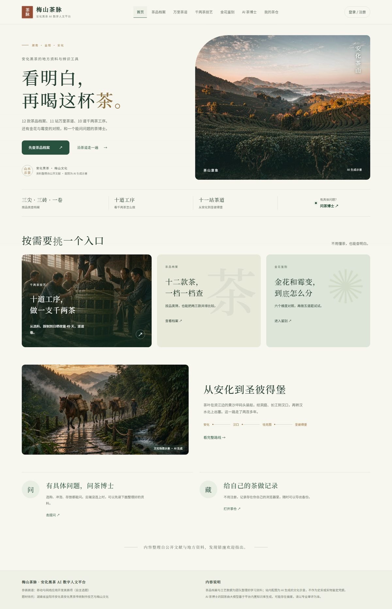
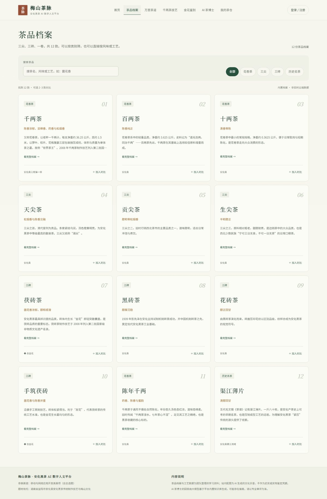
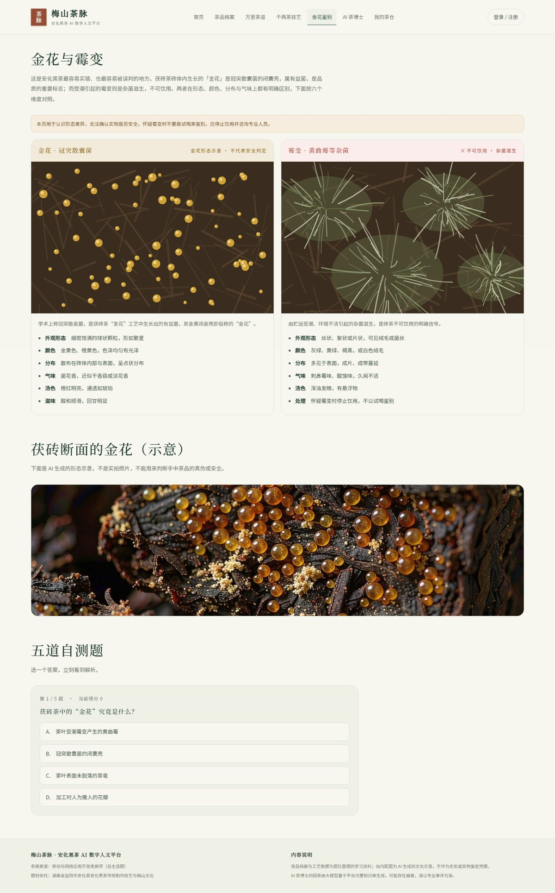
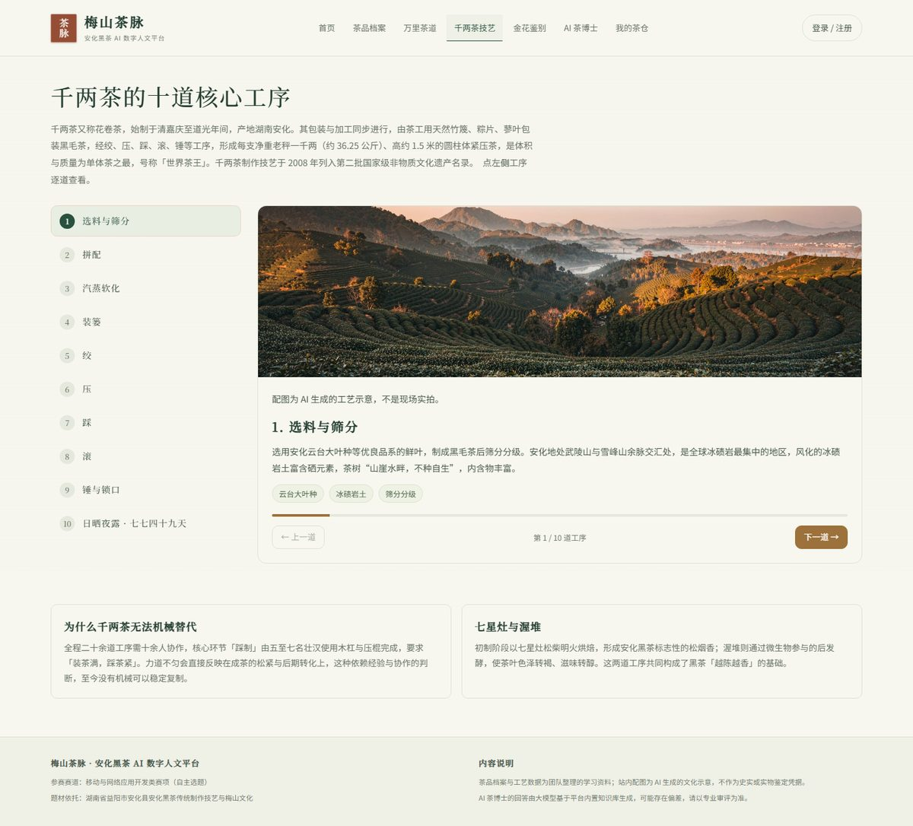
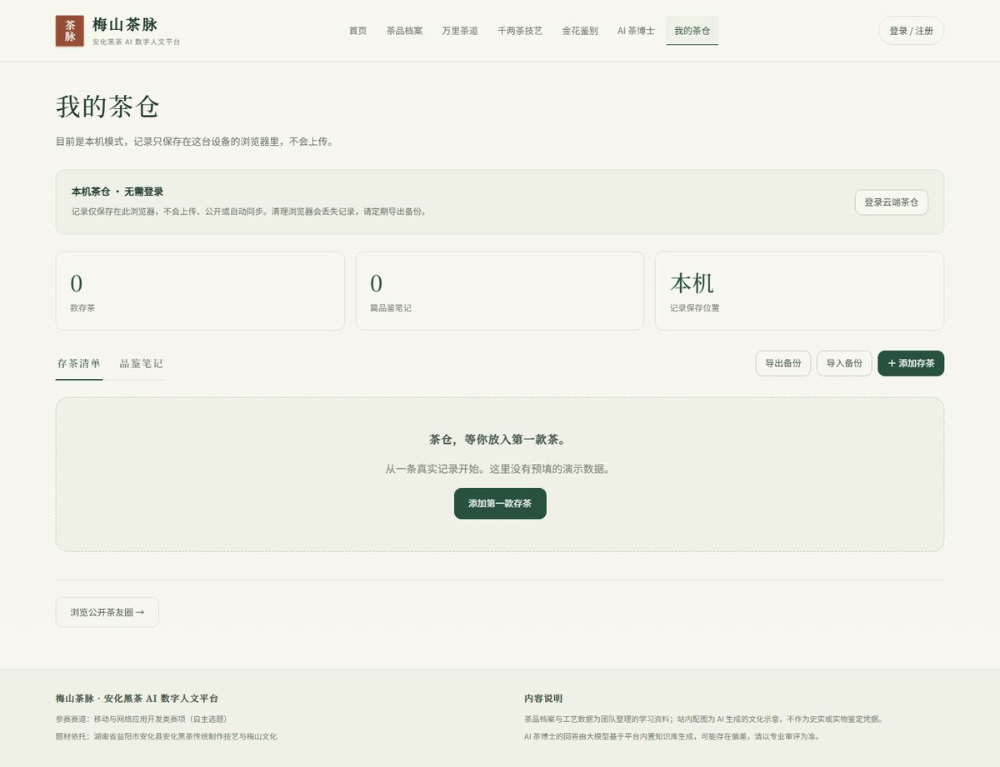
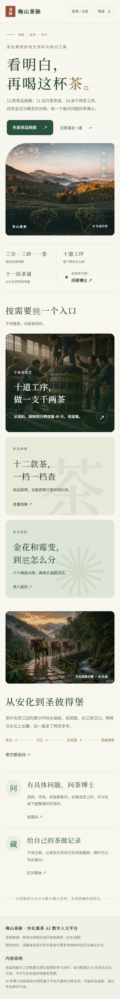

# 梅山茶脉

安化黑茶的地方资料与辨识工具。

十二款茶按品类整理成档案，万里茶道十一站能一段段走，千两茶的十道工序拆开看。金花和霉变怎么分，这里有一张六维对照表；拿不准，可以问茶博士。存茶记录不用注册，存在浏览器里，也能导出。



线上版本：<https://meishan-tea.app.workbuddy.host/>

演示视频：<https://github.com/YI12-jiu/meishan-tea/releases/tag/v1.0>（4 分钟，43 MB）

## 为什么做这个站

安化黑茶不好入门。三尖、三砖、一卷，光名字就能劝退一半人；好不容易买了块茯砖，掰开看见里面长毛，又分不清是金花还是霉变。

团队里有人是安化人。查资料的时候发现，品类、官茶沿革、万里茶道、非遗工序散在县志、茶厂史料和老匠人的口述里，网上多是软文，没法检索。金花和霉变的长相，对没做过茶的人来说几乎一样。黑茶的形象又偏「老」，新茶友不知道从哪问起。

这个站就做三件事：把内容结构化，把最容易出错的判断做成对照工具，再留一个能追问的地方。

## 七个模块

| 模块 | 能做什么 |
| --- | --- |
| 首页 | 四条浏览线索：品类、工序、茶道、问答 |
| 茶品档案 | 12 款茶；按品类筛、按名字搜、2–3 款并排比较 |
| 万里茶道 | 安化黄沙坪到圣彼得堡的 11 站，配 10 个历史节点 |
| 千两茶技艺 | 10 道工序，前后翻看，会话内记住位置 |
| 金花鉴别 | 六维对照、菌相示意、五道自测 |
| AI 茶博士 | 只依据平台知识库回答，逐字输出，可中止 |
| 我的茶仓 | 不登录存本机；登录后存云端，带权限隔离 |

## 几个页面

<p>
  
  
</p>
<p>
  
  
</p>

手机端：



## 跑起来

最省事的方式：下载 `离线体验.html`，双击用浏览器打开。单文件，不联网，图片和字体都在里面。

跑完整源码：

```bash
python3 -m http.server 8899 --bind 127.0.0.1
# 打开 http://127.0.0.1:8899
```

不需要 npm，也不需要构建。只有跑测试才要 Node 和 Playwright：

```bash
npm ci
npx playwright install chromium
npm test
```

## 目录

```
.
├── index.html            入口
├── 离线体验.html          单文件版本
├── css/                  样式：基础组件、视觉层、字体声明
├── js/                   路由、视图、云服务封装、本机存储
├── assets/               配图与裁剪过的 Noto 字体
├── vendor/               随包的 WorkBuddy SDK
├── scripts/              打版本号、生成单文件
├── test/                 Playwright 回归
└── docs/                 说明、截图、验证结果
```

## 几个实现上的选择

**不用框架。** 页面不多，原生 JS 够用；打开源码就能读，不用先装依赖。代价是路由和组件复用要自己写，好在量不大。

**云端是可选的。** 默认 `auto`，只在配置的域名下连云端，本地和单文件走本机存储。云 SDK 异步加载，8 秒没起来就不等了，文化内容照常能看。

**权限放在数据库。** 用户表都开了行级安全策略，写操作只对已登录角色开放。前端不发 owner 字段，也不靠隐藏按钮做隔离。

**缓存靠内容哈希。** 托管环境不下发 `Cache-Control`，浏览器会启发式缓存，改了代码访客还看旧页面。`index.html` 里的 css/js 引用都带文件内容 sha256 的前 8 位，改了就换 URL。`python3 scripts/stamp-assets.py` 一条命令重算。

**AI 被限制在知识库里。** 茶博士的系统提示词内置了一份按板块整理的安化黑茶资料和六条回答准则：不确定要说不知道，不做功效宣称，不推荐品牌和价格。它仍然会错，所以界面上写了「仅供参考」。

## 踩过的坑

上线第一天，未登录的访客能往数据库里写东西。原因是平台给匿名请求的身份是字符串 `anon`，不是空值，策略里的 `owner_id = auth.uid()` 变成了 `'anon' = 'anon'`，直接放行。把写策略的角色收窄到 `authenticated` 之后才拦住。

同一周还遇到整站发灰、点不动。查下来是弹窗遮罩在样式表里写死了 `display:flex`，盖住页面还吞掉了点击。`element.click()` 的自动化测试发现不了这种问题，后来补了 `elementFromPoint` 的命中检查。

两件事都写进了[设计说明](docs/设计说明.md)。

## 测试

本地 Chromium 里真实点击七个路由和关键交互，23 项；另一组直接加载随包 SDK，用本地 HTTP fixture 跑协议，12 项。两组都阻断外部请求，结果在 `docs/verification/`。

它们覆盖的是前端逻辑和协议层。真实邮箱投递、线上模型质量、手机 Safari 仍然要人工验。

## 已知问题

- 云端登录只在正式发布域名下生效，本地预览登录不了是预期行为
- 手机 Safari 和微信内置浏览器还没完整实测
- 金花配图是 AI 生成的示意图，不能当实物凭据
- 茶品档案里的年份、产地还没逐条做过文献审查

## 文档

- [设计说明](docs/设计说明.md)：功能、架构、数据与权限、测试范围
- [AI 使用说明](docs/AI使用说明.md)：用了哪些工具、用在哪、改过哪些错

## 版权与 AI

代码和文字由团队编写，开发过程中用了大语言模型辅助，范围见 AI 使用说明。配图由文生图工具生成，界面里都标了「AI 生成示意」。字体是 Noto Serif SC / Noto Sans SC 的裁剪子集，按 SIL OFL 1.1 分发；云 SDK 按 MIT 分发。除此之外没有引用第三方素材。
